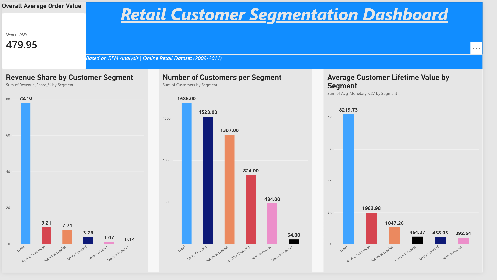

# Retail Customer Segmentation using RFM Analysis

## 📌 Overview
This project analyzes ~800K+ transaction records from an online UK retail store to segment 
customers based on their purchasing behavior. Using RFM (Recency, Frequency, Monetary) analysis, 
customers were grouped into actionable segments, and business recommendations were derived to 
help the company improve revenue through targeted retention strategies.

## 🎯 Objective
- Analyze customer purchase history
- Segment customers (Loyal, At-risk, Churned, Discount-seeker, New, Potential Loyalist)
- Calculate key business metrics: AOV (Average Order Value) and CLV (Customer Lifetime Value)
- Provide data-driven recommendations for revenue growth

## 📊 Dataset
- **Source:** [Online Retail II (UCI Machine Learning Repository)](https://archive.ics.uci.edu/dataset/502/online+retail+ii)
- **Size:** 1,067,371 transactions | Dec 2009 – Dec 2011
- **Fields:** Invoice, StockCode, Description, Quantity, InvoiceDate, Price, Customer ID, Country

## 🛠️ Tools Used
- **Python** (Pandas, NumPy, Matplotlib, Seaborn) — data cleaning, RFM calculation, segmentation
- **Power BI** — interactive dashboard and visualization
- **Jupyter Notebook**

## 🔍 Approach
1. **Data Cleaning:** Removed cancelled orders, missing Customer IDs, and invalid (negative/zero) 
   quantity or price records. Final clean dataset: 805,549 transactions.
2. **RFM Calculation:** Computed Recency, Frequency, and Monetary value for 5,878 unique customers.
3. **Scoring & Segmentation:** Scored each customer 1–5 on R, F, M using quantile-based scoring, 
   then classified into 6 business segments.
4. **Metrics:** Calculated Overall AOV and segment-wise CLV.
5. **Visualization:** Built an interactive Power BI dashboard summarizing key metrics.

## 📈 Key Insights
- **78.1% of total revenue comes from just 29% of customers** (Loyal segment) — a clear Pareto 
  (80/20) pattern.
- Overall Average Order Value (AOV): **£479.95**
- Loyal customers have an average CLV of **£8,219**, nearly 4x higher than the At-risk segment (£1,983).
- 1,523 customers (26%) are Lost/Churned, but they contribute only 3.76% of revenue — low 
  priority for retention spend.
- 824 customers are At-risk/Churning — previously valuable customers who are going inactive, 
  representing the highest-priority recovery opportunity.

## 💡 Business Recommendations
| Segment | Recommendation |
|---|---|
| Loyal | Retain via loyalty programs, early access, personalized offers |
| At-risk/Churning | Urgent win-back campaigns (targeted discounts, re-engagement emails) |
| Lost/Churned | Minimal-cost win-back only; don't over-invest |
| Potential Loyalist | Incentivize to convert into Loyal segment |
| New Customer | Focus on onboarding and driving a second purchase |
| Discount-seeker | Low business impact; no dedicated strategy needed |

## 📊 Power BI Dashboard


## 🚀 How to Run
1. Download the dataset from the link above
2. Run `customer_segmentation_rfm.ipynb` in Jupyter Notebook
3. Open `retail_segmentation_dashboard.pbix` in Power BI Desktop to explore the interactive dashboard

## 📁 Repository Structure
```
retail-customer-segmentation-rfm/
│
├── customer_segmentation_rfm.ipynb
├── retail_segmentation_dashboard.pbix
├── dashboard_screenshot.png
└── README.md
```